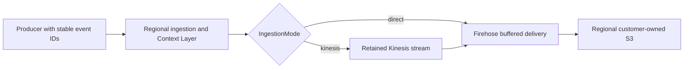

# Capacity, concurrency and delivery reliability

## Monthly request planning examples

These are planning examples, not measured capacity guarantees. Assumptions: 30 days, peak traffic 10 times monthly average, p95 handler duration no more than 100 ms, and 70 percent target utilization. The model accounts for both concurrent execution duration and the Function URL limit of 10 times reserved concurrency in requests/sec. Round up, then validate with your actual traffic, Context Layer and account quotas.

| HTTP requests per month, per region | Average requests/sec | Assumed 10x peak requests/sec | Modeled starting reserved concurrency |
| --- | ---: | ---: | ---: |
| 1 million | 0.39 | 3.9 | 10 |
| 10 million | 3.86 | 38.6 | 10 |
| 100 million | 38.58 | 385.8 | 60 |
| 350 million | 135.03 | 1350.3 | 200 |
| 1 billion | 385.80 | 3858.0 | 560 |

Two hundred reserved concurrency is sufficient for these modeled 1M/10M request workloads, but is not their minimum requirement. Reservations also consume account concurrency available to other functions. Marketplace's default is 100; choose a setting your platform team can support. A 500 ms auth-heavy handler changes the 350M-request example to approximately 970 reserved concurrency. At 25 events per HTTP request, 350M **events** is only 14M HTTP requests; under the stated assumptions its modeled starting point is 10. Model larger bursts separately.

```json
{
  "monthlyRequests": 10000000,
  "burstFactor": 10,
  "p95DurationMs": 100,
  "targetUtilization": 0.7,
  "suggestedReservedConcurrency": 10
}
```

The planning rule is the greater of peak requests/sec multiplied by p95 seconds divided by target utilization, and peak requests/sec divided by 10 and target utilization. This is a heuristic; p95 is not a hard latency bound. Recheck cold starts, the function scaling ramp and account concurrency. See [AWS Function URL throttling](https://docs.aws.amazon.com/lambda/latest/dg/urls-configuration.html#urls-throttling) and [Lambda quotas](https://docs.aws.amazon.com/lambda/latest/dg/gettingstarted-limits.html).


## Buffered delivery with selective retries

Eventing provides **buffered delivery with selective retries**, not guaranteed end-to-end delivery. There is no zero-loss, exactly-once or event-ordering guarantee.

- **HTTP 202 is stream acceptance.** All submitted records were acknowledged by Firehose in direct mode, or Kinesis in retained-stream mode. It does not confirm arrival in S3 or delivery to any downstream destination.
- **Retries are bounded.** The runtime selectively retries records explicitly reported as failed; it does not resend acknowledged records in those retries. The runtime permits three application submission rounds; AWS SDK retries are separate. An API/transport error or exhausted retries returns HTTP 502. A failed request may already have accepted some records; a timeout can leave the outcome unknown.
- **Loss and duplicates remain possible.** Events that never reach ingestion, exhaust producer retries, or cannot be recovered before buffer retention expires can be lost. Client retries and uncertain write outcomes can produce duplicates. Preserve stable event IDs and deduplicate in the appropriate tenant/namespace scope. The service has no server-side deduplication store or guaranteed replay of rejected requests.
- **Recovery needs an owner.** Persist pending events in a durable producer queue when required. Monitor ingestion errors/throttles, delivery freshness, error prefixes and actual S3 arrival; investigate failures and reconcile expected IDs against stored records. Metrics alone do not prove every event arrived.
- **Buffering is not a delivery guarantee.** The default path is Lambda → Firehose → S3; retained-stream mode adds Kinesis before Firehose. Downstream filtering, forwarding, retries and destination acknowledgements are customer-owned.

## Delivery options

Firehose is the default (`IngestionMode=direct`). Choose `IngestionMode=kinesis` to add a retained stream before Firehose. Validate deployment, outage recovery and costs in your test environment before production rollout.

| Feature | Firehose only | Kinesis → Firehose |
| --- | --- | --- |
| Choose when | Buffered S3 delivery meets your needs | You need a retained stream or customer-built consumers |
| HTTP 202 | Firehose accepted every record | Kinesis accepted every record; Firehose and S3 delivery remain asynchronous |
| Retention | Service-managed buffering; no ingress replay stream | 24–8760 hours; default 24. Expired records cannot be recovered |
| Capacity | Lambda and Firehose quotas | On-demand Standard, or provisioned shards; size for writes and backlog catch-up |
| Extra AWS cost | Existing ingestion and storage charges | Stream capacity/usage, reads, extended retention and optional metrics/KMS; Firehose and S3 still apply |
| Recovery | Your producer queues and stored data | Your recovery process within retention; no replay job or extra consumer is bundled |

Neither path guarantees delivery, ordering or exactly-once processing. Monthly concurrency examples model Lambda, not Kinesis throughput.

Choose the mode at installation creation. Existing installations need a planned migration: drain, reconcile, then move producers. S3 and the stream are retained on stack deletion and can continue billing.

```json
{
  "IngestionMode": "kinesis",
  "DurableRetentionHours": 72,
  "KinesisCapacityMode": "ON_DEMAND",
  "KinesisEnhancedMonitoring": "false"
}
```

Start with 24-hour retention unless your recovery objective needs more. Provisioned mode also accepts `KinesisShardCount`. Monitor write throttles, reader lag and S3 arrival; longer retention does not add throughput. Reducing retention can expire records. Configure encryption with `KmsKeyArn` and provision matching IAM boundaries before restricted-account launch. On-demand Advantage, warm throughput and enhanced fan-out are outside this option.

See the [configuration guide](configuration.md), [AWS stream settings](https://docs.aws.amazon.com/AWSCloudFormation/latest/TemplateReference/aws-resource-kinesis-stream.html), [Kinesis pricing](https://aws.amazon.com/kinesis/data-streams/pricing/) and [Firehose pricing](https://aws.amazon.com/firehose/pricing/). Calculator figures are planning estimates, not measured bills.

## Measured baseline, 19 October 2026

The existing internal Bookcicle dev API had 200 reserved concurrency, 256 MiB ARM64 Lambda memory and a 60-second timeout. It predates the Marketplace runtime and the retry patch; these observations do not certify the Marketplace release or a different customer's configuration.

| Test | Batch size | Duration | Accepted events | HTTP errors |
| --- | ---: | ---: | ---: | ---: |
| 150 events/sec target | 25 | 60 seconds | 9000 | 0 |
| 250 events/sec target | 25 | 60 seconds | 15000 | 0 |

Including the five-event smoke test, all 24005 synthetic event IDs were observed in S3 with no duplicates in that observation window. CloudWatch showed zero errors/throttles, at most six concurrent executions, warm one-minute p95 durations of approximately 19–24 ms and Firehose data freshness up to 65 seconds. HTTP p99 was approximately 489 ms in the first run and 4736 ms in the higher run; client and edge latency are not equivalent to Lambda execution duration. Minute-level metrics include any other concurrent dev traffic.

This demonstrates short runs above the average event rate associated with 350M/month. It does not demonstrate an hour-long steady load, 1500/15000 events/sec bursts, regional isolation, recovery under a real Firehose outage, or an actual monthly bill.

## Authentication overhead

A sequential x86_64 Linux debug-build benchmark of 3000 requests with 25 events each used the real handler and a synthetic delivery sink. Anonymous handler p50 was about 0.54 ms and p95 0.55 ms. The demo subprocess layer raised p50 to about 1.38 ms and p95 to 4.93 ms. These are host measurements, excluding Lambda cold starts, AWS network and delivery; they are not ARM64 Lambda timings. Benchmark the customer's JWT/JWKS layer and any identity-provider lookups separately. Keep timeouts, payload bounds and fail-closed authorization enabled.

## Other limits and costs

Batching reduces HTTP/Lambda request counts, not data bytes. Check regional [Firehose quotas](https://docs.aws.amazon.com/firehose/latest/dev/limits.html), WAF per-IP limits and body inspection, Firehose partition quotas, S3 delivery freshness, SDK retry overhead and account quotas. Default managed WAF rules may reject bodies over 8192 bytes, so the 1 MiB runtime ceiling is not a safe default browser batch size. Small synthetic events in the baseline do not represent 1 KiB customer events or realistic compressibility.

Measure request count, billed Lambda duration, memory, enriched bytes, Firehose record rounding, S3 object count/storage and delivery lag. Include CloudFront, WAF, logs/alarms, KMS, dynamic partitioning and the optional service limiter's DynamoDB transactional/replicated writes and storage in cost estimates. The license and AWS usage charges are separate. Official rates: [Lambda](https://aws.amazon.com/lambda/pricing/), [Firehose](https://aws.amazon.com/firehose/pricing/).

## IDs and duplicate handling

The SDKs generate a random UUID `event_id` before enqueueing when you omit it;
you do not need to generate one yourself. A producer using an application outbox
can supply its existing opaque ID. Use one ID per logical event, keep it stable
on replay, and never put personal data or credentials in it. Explicit IDs must
be nonempty strings of at most 128 UTF-8 bytes, without control characters or
surrounding whitespace. The backend and all four SDKs reject invalid
explicit IDs rather than trimming or replacing them. Requests that omit IDs,
including legacy shapes, still get a backend-generated fallback. That fallback
is new on each HTTP request and cannot identify a producer replay.

`track` persists a snapshot containing the ID, event timestamp, SID and filtered
properties before returning the ID. Retry pending events with `flush` or automatic
queue recovery. Calling `track` again without the original ID creates a new event;
an explicit ID already pending in that client's queue is rejected. There is no
permanent idempotency record after the SDK removes an accepted event.

Distinguish event snapshots from request envelopes. Within one SDK retry round,
all attempts use identical serialized HTTP bytes and the same `batch_id`. A later
flush, recovery round or restarted process may rebuild the batch and generate a
new batch ID; the queued event snapshots remain unchanged. The standalone
Python/Rust/curl producers serialize one request per invocation and reuse its
exact bytes for their bounded retries. Starting a new CLI invocation generates
new events, IDs and timestamps; it is not replay of a previous invocation.

Scope downstream deduplication by installation, verified tenant when present,
namespace and event ID. For anonymous events, use the installation and namespace,
not a caller-claimed tenant. Define retention and a policy for conflicting
payloads with the same ID, including changed SIDs. Compare the immutable event
fields, not server-generated `received_at`, request IDs or batch metadata, which
can change between submissions. Neither `sid`, `batch_id` nor
the request hash replaces `event_id`. Query-time deduplication does not prevent
duplicate ingestion, writes or charges.

Partial delivery retries resend only failed Firehose records, which may contain
multiple NDJSON events. Accepted earlier records are excluded from those retries.
The optional Kinesis path likewise retries failed stream records. Timeouts and
exhausted retries can leave partial or uncertain outcomes. HTTP 202 acknowledges
acceptance into the configured stream, not completed S3 delivery. There is no
exactly-once guarantee or server-side deduplication store. The new quota table
stores admission counters, not delivery receipts or event deduplication keys.

## SDK sessions and service rate limits

The packaged stack layers application quotas after WAF and authorization.
Default identity limits are **100 HTTP requests/minute per enabled region**.
A batch of 25 events consumes one request, not 25; event and byte caps are separate.
Limits use fixed UTC minute windows, allowing two windows' quota around a boundary.
The configured Global Table replicates only across enabled ingestion regions,
but region-prefixed keys keep admission counters independent. Three regions do
not share one 100 RPM budget. Preserve `RateLimitOwnerRegion` when adding replicas.

| Traffic | Identity bucket | Additional ceiling |
| --- | --- | --- |
| Authenticated | Verified session ID, otherwise verified subject | 10,000 RPM per verified tenant by default |
| Anonymous with client SID | Default 100 RPM per SID | 1,000 RPM across all anonymous traffic by default |
| Anonymous without SID | Shared anonymous bucket only | Same 1,000 RPM anonymous ceiling |

Tier overrides come only from verified `rate_limit_tier` auth context and must
match configured `RateLimitTiers`. Anonymous SID rotation cannot raise that shared
ceiling or select a tier. The quota check atomically reserves all applicable
buckets; one exhausted bucket rejects the whole batch. An anonymous batch with
multiple SIDs charges one request per distinct SID plus one shared request; at
most 99 SIDs are allowed, and every SID is charged the whole batch's byte count.

All four SDKs create a default UUID SID for each client instance. Set `sid` on
`track` to override it for that event, or use `context.sid`; top-level `sid` wins.
For a server sharing one SDK client across requests within the same endpoint,
verified tenant and authentication identity, supply the request's existing
non-secret analytics session ID. Authentication is resolved per batch, not per
event: different access tokens or tenants require separate clients and queues.
A properly authorized service identity can batch events for its permitted scope. Reuse it for related events. The override does
not change the client's default, and recovery keeps each queued event's SID.
Do not use an auth cookie or token as a SID, or generate new SIDs just to bypass
quotas. An authenticated request's verified auth session/subject still determines
its quota bucket; an event SID cannot impersonate another verified identity.

A long-lived anonymous server SDK with no overrides uses one SID and therefore
shares a single 100 RPM bucket across all its events. Configure an appropriate
producer policy or verified service tier for bulk server ingestion. The monthly
capacity table does not override quotas: 10M requests/month is about 232 RPM on
average and roughly 2,300 RPM at its modeled 10x peak. That exceeds one default
identity bucket, and its peak exceeds the default anonymous ceiling. Increasing
Lambda concurrency alone does not raise either limit.

Exhaustion returns `429` with `Retry-After`; default limiter failures return `503`
with `Retry-After: 1`. Current SDKs retain failed batches and apply their configured
backoff/recovery interval; they do not yet honor `Retry-After`. Size queues for the
outage and recovery rate: at a 100 RPM identity quota and batches averaging 25
events, the nominal admission budget is 2,500 events/minute before byte limits,
partial batches, retries and delivery failures. Retries admitted after an uncertain
delivery consume another request and can produce duplicates. Reservations are not
refunded after downstream failure; limiter timeouts may already have committed.

The DynamoDB reservation adds a regional network operation, transactional writes
and replicated writes/storage. The current cost calculator does not include
these limiter charges. Hot identity/tenant buckets can contend or throttle.
Existing latency baselines above excluded this limiter; benchmark the complete
path under realistic identities and bursts before using the concurrency model.
Monitor `RateLimitLimited`, `RateLimitUnavailable`, `RateLimitBypassed`, DynamoDB
throttles/conflicts and SDK queue depth. `RateLimitFailureMode=open` explicitly
permits unmetered ingestion during a limiter failure and must be monitored.

See [service quota configuration](configuration.md#service-rate-limits) for all
request/event/byte defaults, tier policy JSON, permissions and ownership changes.
See the [SDK guide](https://eventing.bookcicle.com/#guides-sdk) for per-event SID examples in each runtime.

## Configured delivery paths

Regional Rust ingestion delivers to the selected region’s S3 bucket through Firehose. `IngestionMode=kinesis` adds a retained Kinesis stream before Firehose. Size concurrency, stream capacity, producer queues and monitoring for the selected path.



## Context Layer processing and retries

A Context Layer runs once per batch before namespace authorization and admission. Version 2 receives sanitized events and may enrich request context or mutate event names, properties and context; the runtime validates the complete transformed envelope again. IDs, event times and incoming SIDs remain unchanged. Anonymous SID quota buckets use the incoming payload; verified identity and rate tiers come only from the separate authentication result. General request context cannot grant privileges.

Budget for the hook's CPU, output size and 1500 ms default deadline when planning Lambda concurrency. Both direct Firehose and Kinesis delivery run through the same hook and admission path. A retried request can invoke the hook again, so make transformations deterministic and version their policy. Downstream deduplication must account for conflicting transformed payloads after policy upgrades. See the [Context Layer guide](auth-layer.md).

## Expanding geographic coverage

The initial ingestion region is us-east-1. `ResidencyMode=nearest` selects the closest enabled origin using approximate viewer coordinates, with the default origin used when location is missing. Start with one region and add origins as geographic traffic warrants; up to five distinct slots are available in the coordinated stack, including two additional slots for multiple regions in the same geography. The five core choices are Northern Virginia (`us-east-1`), Oregon (`us-west-2`), Ireland (`eu-west-1`), Frankfurt (`eu-central-1`) and Singapore (`ap-southeast-1`). Sydney (`ap-southeast-2`) and Tokyo (`ap-northeast-1`) are also in the configured catalog. Catalog availability is separate from enabled capacity: the coordinated stack has five slots. Northern California and Ohio are router-recognized expansion locations, not selectable choices in the configured catalog. See [supported ingestion regions](configuration.md#supported-ingestion-regions).

Each enabled ingestion region delivers to its own S3 bucket in your AWS account. The selected origin determines the storage destination, including requests using the default-origin fallback. The package does not replicate event objects across regions or consolidate them into one bucket. Plan downstream queries and reconciliation across all regional buckets. Routing changes affect future requests, not historical objects; retained buckets remain subject to their configured lifecycle expiration.

Routing rankings update with enabled origin changes; country groups are used only by the explicitly selected legacy residency modes. Proximity is neither a live latency measurement nor health failover. Requests are not automatically replayed cross-region after an origin failure. Keep event IDs stable on producer retries, account for per-region quota windows, keep the quota-table owner stable, and drain queues/buffers before removing a region. See [dynamic geographic routing](configuration.md#dynamic-geographic-routing).


## Test environment isolation

Use a separate `Stage=test` installation and its own endpoint for synthetic traffic. The default is one origin and seven-day event/log retention when the retention parameters are zero. Test uses the same auth, quota, batching, retry and delivery behavior as production. Set each SDK client's `environment` to `test`; its queues bind to the endpoint, environment and default namespace, and reject conflicting reuse before recovery starts. Nonempty legacy unbound queues must be drained or explicitly migrated. An environment label does not prove the endpoint is a test deployment. See [test environments](configuration.md#test-environments).
