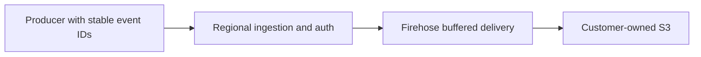

# Capacity, concurrency and delivery reliability

## Monthly request planning examples

These are planning examples, not measured capacity guarantees. Assumptions: 30 days, peak traffic 10 times monthly average, p95 handler duration no more than 100 ms, and 70 percent target utilization. The model accounts for both concurrent execution duration and the Function URL limit of 10 times reserved concurrency in requests/sec. Round up, then validate with your actual traffic, auth layer and account quotas.

| HTTP requests per month, per region | Average requests/sec | Assumed 10x peak requests/sec | Modeled starting reserved concurrency |
| --- | ---: | ---: | ---: |
| 1 million | 0.39 | 3.9 | 10 |
| 10 million | 3.86 | 38.6 | 10 |
| 100 million | 38.58 | 385.8 | 60 |
| 350 million | 135.03 | 1350.3 | 200 |
| 1 billion | 385.80 | 3858.0 | 560 |

Two hundred reserved concurrency is sufficient for these modeled 1M/10M request workloads, but is not their minimum requirement. Reservations also consume account concurrency available to other functions. Marketplace's default is 100; choose a setting your platform team can support. A 500 ms auth-heavy handler changes the 350M-request example to approximately 970 reserved concurrency. At 25 events per HTTP request, 350M **events** is only 14M HTTP requests; under the stated assumptions its modeled starting point is 10. Model larger bursts separately.

```json
{
  "monthlyRequests": 10000000,
  "burstFactor": 10,
  "p95DurationMs": 100,
  "targetUtilization": 0.7,
  "suggestedReservedConcurrency": 10
}
```

The planning rule is the greater of peak requests/sec multiplied by p95 seconds divided by target utilization, and peak requests/sec divided by 10 and target utilization. This is a heuristic; p95 is not a hard latency bound. Recheck cold starts, the function scaling ramp and account concurrency. See [AWS Function URL throttling](https://docs.aws.amazon.com/lambda/latest/dg/urls-configuration.html#urls-throttling) and [Lambda quotas](https://docs.aws.amazon.com/lambda/latest/dg/gettingstarted-limits.html).


## Buffered delivery with selective retries

Eventing provides **buffered delivery with selective retries**, not guaranteed end-to-end delivery. There is no zero-loss, exactly-once or event-ordering guarantee.

- **HTTP 202 is stream acceptance.** In the published delivery path, all submitted records were acknowledged by Firehose. It does not confirm arrival in S3 or delivery to any downstream destination.
- **Retries are bounded.** The runtime selectively retries records explicitly reported as failed; it does not resend acknowledged records in those retries. The candidate implementation permits three application submission rounds; AWS SDK retries are separate. An API/transport error or exhausted retries returns HTTP 502. A failed request may already have accepted some records; a timeout can leave the outcome unknown.
- **Loss and duplicates remain possible.** Events that never reach ingestion, exhaust producer retries, or cannot be recovered before buffer retention expires can be lost. Client retries and uncertain write outcomes can produce duplicates. Preserve stable event IDs and deduplicate in the appropriate tenant/namespace scope. The service has no server-side deduplication store or guaranteed replay of rejected requests.
- **Recovery needs an owner.** Persist pending events in a durable producer queue when required. Monitor ingestion errors/throttles, delivery freshness, error prefixes and actual S3 arrival; investigate failures and reconcile expected IDs against stored records. Metrics alone do not prove every event arrived.
- **Buffering is not a delivery guarantee.** The published path is Lambda → Firehose → S3. Downstream filtering, forwarding, retries and destination acknowledgements are customer-owned.

## Delivery options

Firehose is the default. Kinesis buffering is a next-release candidate, absent from published 0.1.4. Dedicated-account deployment, outage/recovery and cost tests are pending.

| Feature | Firehose only | Kinesis → Firehose |
| --- | --- | --- |
| Choose when | Buffered S3 delivery meets your needs | You need a retained stream or customer-built consumers |
| HTTP 202 | Firehose accepted every record | Kinesis accepted every record; Firehose and S3 delivery remain asynchronous |
| Retention | Service-managed buffering; no ingress replay stream | 24–8760 hours; default 24. Expired records cannot be recovered |
| Capacity | Lambda and Firehose quotas | On-demand Standard, or provisioned shards; size for writes and backlog catch-up |
| Extra AWS cost | Existing ingestion and storage charges | Stream capacity/usage, reads, extended retention and optional metrics/KMS; Firehose and S3 still apply |
| Recovery | Your producer queues and stored data | Your recovery process within retention; no replay job or extra consumer is bundled |

Neither path guarantees delivery, ordering or exactly-once processing. Monthly concurrency examples model Lambda, not Kinesis throughput.

Choose the mode at installation creation. Existing installations need a planned migration: drain, reconcile, then move producers. S3 and the stream are retained on stack deletion and can continue billing.

```json
{
  "IngestionMode": "kinesis",
  "DurableRetentionHours": 72,
  "KinesisCapacityMode": "ON_DEMAND",
  "KinesisEnhancedMonitoring": "false"
}
```

Start with 24-hour retention unless your recovery objective needs more. Provisioned mode also accepts `KinesisShardCount`. Monitor write throttles, reader lag and S3 arrival; longer retention does not add throughput. Reducing retention can expire records. Configure encryption with `KmsKeyArn` and provision matching IAM boundaries before restricted-account launch. On-demand Advantage, warm throughput and enhanced fan-out are outside this option.

See the [configuration guide](configuration.md), [AWS stream settings](https://docs.aws.amazon.com/AWSCloudFormation/latest/TemplateReference/aws-resource-kinesis-stream.html), [Kinesis pricing](https://aws.amazon.com/kinesis/data-streams/pricing/) and [Firehose pricing](https://aws.amazon.com/firehose/pricing/). Calculator figures are planning estimates, not measured bills.

## Measured baseline, 19 October 2026

The existing internal Bookcicle dev API had 200 reserved concurrency, 256 MiB ARM64 Lambda memory and a 60-second timeout. It predates the Marketplace runtime and the retry patch; these observations do not certify the Marketplace release or a different customer's configuration.

| Test | Batch size | Duration | Accepted events | HTTP errors |
| --- | ---: | ---: | ---: | ---: |
| 150 events/sec target | 25 | 60 seconds | 9000 | 0 |
| 250 events/sec target | 25 | 60 seconds | 15000 | 0 |

Including the five-event smoke test, all 24005 synthetic event IDs were observed in S3 with no duplicates in that observation window. CloudWatch showed zero errors/throttles, at most six concurrent executions, warm one-minute p95 durations of approximately 19–24 ms and Firehose data freshness up to 65 seconds. HTTP p99 was approximately 489 ms in the first run and 4736 ms in the higher run; client and edge latency are not equivalent to Lambda execution duration. Minute-level metrics include any other concurrent dev traffic.

This demonstrates short runs above the average event rate associated with 350M/month. It does not demonstrate an hour-long steady load, 1500/15000 events/sec bursts, regional isolation, recovery under a real Firehose outage, or an actual monthly bill.

## Authentication overhead

A sequential x86_64 Linux debug-build benchmark of 3000 requests with 25 events each used the real handler and a synthetic delivery sink. Anonymous handler p50 was about 0.54 ms and p95 0.55 ms. The demo subprocess layer raised p50 to about 1.38 ms and p95 to 4.93 ms. These are host measurements, excluding Lambda cold starts, AWS network and delivery; they are not ARM64 Lambda timings. Benchmark the customer's JWT/JWKS layer and any identity-provider lookups separately. Keep timeouts, payload bounds and fail-closed authorization enabled.

## Other limits and costs

Batching reduces HTTP/Lambda request counts, not data bytes. Check regional [Firehose quotas](https://docs.aws.amazon.com/firehose/latest/dev/limits.html), WAF per-IP limits and body inspection, Firehose partition quotas, S3 delivery freshness, SDK retry overhead and account quotas. Default managed WAF rules may reject bodies over 8192 bytes, so the 1 MiB runtime ceiling is not a safe default browser batch size. Small synthetic events in the baseline do not represent 1 KiB customer events or realistic compressibility.

Measure request count, billed Lambda duration, memory, enriched bytes, Firehose record rounding, S3 object count/storage and delivery lag. Include CloudFront, WAF, logs/alarms, KMS, dynamic partitioning in cost estimates. The license and AWS usage charges are separate. Official rates: [Lambda](https://aws.amazon.com/lambda/pricing/), [Firehose](https://aws.amazon.com/firehose/pricing/).

## IDs and duplicate handling

Generate an opaque immutable `event_id` in the producer before enqueueing; do not put personal data in IDs. Preserve the ID and serialized payload when retrying. The SDK and Python/Rust/curl examples do this. Server-generated fallback IDs support legacy requests but cannot identify repeated HTTP requests that omitted IDs. Scope downstream deduplication by verified tenant, namespace and event ID; define a retention window and a policy for conflicting payloads with the same ID. Query-time deduplication does not prevent duplicate writes or charges.

Partial delivery retries resend only failed Firehose records, which may each contain multiple NDJSON events. Accepted earlier records are excluded from those retries. Timeouts and exhausted retries still have uncertain or partial outcomes; preserve IDs across client retries. HTTP 202 acknowledges acceptance into the configured delivery stream, not completed S3 delivery. There is no exactly-once guarantee or server-side deduplication store.

## Published delivery path

The published architecture is regional Rust Lambda → Firehose → customer-owned S3. Size concurrency, Firehose capacity, producer queues and monitoring for this path.


