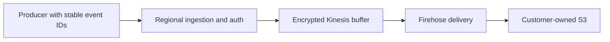

# Capacity, concurrency and delivery reliability

Size each region using peak HTTP requests per second, request duration, batch size and payload bytes. Monthly event counts alone do not determine reserved concurrency. With 25 events per request, 350 million events per 30-day month averages about 135 events/sec but only 5.4 HTTP requests/sec.

## Monthly request planning examples

These are planning examples, not measured capacity guarantees. Assumptions: 30 days, peak traffic 10 times monthly average, p95 handler duration no more than 100 ms, and 70 percent target utilization. The model accounts for both concurrent execution duration and the Function URL limit of 10 times reserved concurrency in requests/sec. Round up, then validate with your actual traffic, auth layer and account quotas.

| HTTP requests per month, per region | Average requests/sec | Assumed 10x peak requests/sec | Modeled starting reserved concurrency |
| --- | ---: | ---: | ---: |
| 1 million | 0.39 | 3.9 | 10 |
| 10 million | 3.86 | 38.6 | 10 |
| 100 million | 38.58 | 385.8 | 60 |
| 350 million | 135.03 | 1350.3 | 200 |
| 1 billion | 385.80 | 3858.0 | 560 |

Two hundred reserved concurrency is sufficient for these modeled 1M/10M request workloads, but is not their minimum requirement. Reservations also consume account concurrency available to other functions. Marketplace's default is 100; choose a setting your platform team can support. A 500 ms auth-heavy handler changes the 350M-request example to approximately 970 reserved concurrency. At 25 events per HTTP request, 350M **events** is only 14M HTTP requests; under the stated assumptions its modeled starting point is 10. Model larger bursts separately.

```json
{
  "monthlyRequests": 10000000,
  "burstFactor": 10,
  "p95DurationMs": 100,
  "targetUtilization": 0.7,
  "suggestedReservedConcurrency": 10
}
```

The planning rule is the greater of peak requests/sec multiplied by p95 seconds divided by target utilization, and peak requests/sec divided by 10 and target utilization. This is a heuristic; p95 is not a hard latency bound. Recheck cold starts, the function scaling ramp and account concurrency. See [AWS Function URL throttling](https://docs.aws.amazon.com/lambda/latest/dg/urls-configuration.html#urls-throttling) and [Lambda quotas](https://docs.aws.amazon.com/lambda/latest/dg/gettingstarted-limits.html).

## Measured baseline, 19 October 2026

The existing internal Bookcicle dev API had 200 reserved concurrency, 256 MiB ARM64 Lambda memory and a 60-second timeout. It predates the Marketplace runtime and the retry patch; these observations do not certify the Marketplace release or a different customer's configuration.

| Test | Batch size | Duration | Accepted events | HTTP errors |
| --- | ---: | ---: | ---: | ---: |
| 150 events/sec target | 25 | 60 seconds | 9000 | 0 |
| 250 events/sec target | 25 | 60 seconds | 15000 | 0 |

Including the five-event smoke test, all 24005 synthetic event IDs were observed in S3 with no duplicates in that observation window. CloudWatch showed zero errors/throttles, at most six concurrent executions, warm one-minute p95 durations of approximately 19–24 ms and Firehose data freshness up to 65 seconds. HTTP p99 was approximately 489 ms in the first run and 4736 ms in the higher run; client and edge latency are not equivalent to Lambda execution duration. Minute-level metrics include any other concurrent dev traffic.

This demonstrates short runs above the average event rate associated with 350M/month. It does not demonstrate an hour-long steady load, 1500/15000 events/sec bursts, regional isolation, recovery under a real Firehose outage, or an actual monthly bill.

## Authentication overhead

A sequential x86_64 Linux debug-build benchmark of 3000 requests with 25 events each used the real handler and a synthetic delivery sink. Anonymous handler p50 was about 0.54 ms and p95 0.55 ms. The demo subprocess layer raised p50 to about 1.38 ms and p95 to 4.93 ms. These are host measurements, excluding Lambda cold starts, AWS network and delivery; they are not ARM64 Lambda timings. Benchmark the customer's JWT/JWKS layer and any identity-provider lookups separately. Keep timeouts, payload bounds and fail-closed authorization enabled.

## Other limits and costs

Batching reduces HTTP/Lambda request counts, not data bytes. Check regional [Firehose quotas](https://docs.aws.amazon.com/firehose/latest/dev/limits.html), WAF per-IP limits and body inspection, Firehose partition quotas, S3 delivery freshness, SDK retry overhead and account quotas. Default managed WAF rules may reject bodies over 8192 bytes, so the 1 MiB runtime ceiling is not a safe default browser batch size. Small synthetic events in the baseline do not represent 1 KiB customer events or realistic compressibility.

Measure request count, billed Lambda duration, memory, enriched bytes, Firehose record rounding, S3 object count/storage and delivery lag. Include CloudFront, WAF, logs/alarms, KMS, dynamic partitioning and optional buffering in cost estimates. The license and AWS usage charges are separate. Official rates: [Lambda](https://aws.amazon.com/lambda/pricing/), [Firehose](https://aws.amazon.com/firehose/pricing/), [Kinesis](https://aws.amazon.com/kinesis/data-streams/pricing/).

## IDs and duplicate handling

Generate an opaque immutable `event_id` in the producer before enqueueing; do not put personal data in IDs. Preserve the ID and serialized payload when retrying. The SDK and Python/Rust/curl examples do this. Server-generated fallback IDs support legacy requests but cannot identify repeated HTTP requests that omitted IDs. Scope downstream deduplication by verified tenant, namespace and event ID; define a retention window and a policy for conflicting payloads with the same ID. Query-time deduplication does not prevent duplicate writes or charges.

Partial delivery retries resend only failed Firehose records, which may each contain multiple NDJSON events. Accepted earlier records are excluded from those retries. Timeouts and exhausted retries still have uncertain or partial outcomes; preserve IDs across client retries. HTTP 202 acknowledges acceptance into the configured delivery stream, not completed S3 delivery. There is no exactly-once guarantee or server-side deduplication store.

## Opt-in durable ingestion

Choose `IngestionMode: kinesis` only when your recovery/replay requirements justify its added AWS usage and retained resources. The default `direct` mode uses Lambda → Firehose → S3. The optional mode uses the same regional boundary and auth controls with an encrypted, on-demand Kinesis buffer before Firehose:



`DurableRetentionHours` defaults to 24 and supports 24–168 hours. Kinesis retention gives a finite recovery/replay window, not indefinite outage protection. HTTP 202 in this mode reports `delivery: async_kinesis_buffered`. It confirms Kinesis acceptance; Firehose/S3 delivery remains asynchronous and can duplicate records. Standard PutRecords does not promise event ordering. Producer backpressure, quota increases and downstream deduplication still matter.

The regional stream is encrypted using the customer KMS key when configured, otherwise the AWS-managed Kinesis key. Ingestion can write only its buffer; Firehose can read only that buffer. Customer-managed roles and boundaries must include these scoped Kinesis and KMS permissions before opting in. Direct installations receive no Kinesis resources or permissions.

Choose the mode when creating a Marketplace installation. Switching a populated installation between modes is a reviewed migration: create a new deployment identity, stop/drain producers, verify final delivery and retained data, then switch traffic. Conditional write-throttle and five-minute Firehose reader-lag alarms are created; configure `AlarmTopicArn`, an owner and appropriate response thresholds. The Kinesis stream is retained on removal; monitor backlog and oldest data age, drain within the retention window and explicitly review retained-resource costs. A separate consumer/replay procedure may be needed after the original Firehose reader is removed. Do not delete the buffer or keys until recovery requirements are satisfied.

The optional mode is prepared in the next release candidate and is not part of the existing 0.1.4 artifacts. Enable it only after a new immutable release is published and accepted. It has local adapter, policy and template validation. Live customer-account acceptance and failure recovery remain rollout gates; the internal dev baseline above used direct Firehose.
